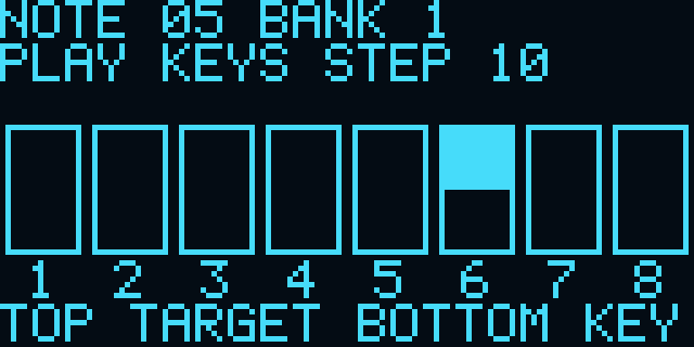

> 2026-10-30最新部署：E049已写入Flash并校验成功，独立读取E049/6020；E050临时SRAM板上测试通过后已恢复正式E049，再次读取E049/6020。OLED实际I2C应答与目标/音区快照、曲谱/映射/ADSR及128块PCM通过。完整冷启动及手机/实体演奏仍未验。[烧录证据](../firmware/e028-extension/docs/e049-flash/README.md) · [板上自测](../firmware/e028-extension/docs/e050-integration/README.md)。以下未烧录状态为历史。

# E049：纸壳外的OLED演奏指引

E049为本轮编译候选，配套App0.12。没有改变音色、音量、合成算法、引脚或巡线模块协议，也没有取消原有四路板载LED输出。板卡实际部署版本以烧录记录为准；编译成功不表示板卡已更新。

## 显示与操作

OLED放在纸壳外可视处，保持现有接线。按板上S2切到第4页（曲目指引）；手机连接时可在App“设置→直连扩展→OLED→曲目指引”切换。脱机曲目用S3启停，手机已连接时用App播放/停止按钮。

- 顶行 `NOTE 12 BANK 1`：目标音符编号12=C4，当前音区1；音区编号1..4对应App音区1..4。
- `BANK 2 STEP 10`：当前音区没有这个目标音，需切到音区2。离线用S1，手机远控时在App演奏设置选择音区。
- `PLAY KEYS STEP 10`：当前音区有能发目标音的键。八个大格标号1..8，**上半格填充表示应按位置，下半格填充表示实际光键触发**。不是两个状态都用同一块实心矩形。
- `REST`：曲谱休止，不突出任何目标键。`UNMAPPED`：四个音区的自定义映射里都没有目标音，请恢复或修改映射。
- 指引按当前自定义键位映射反查，不把目标音编号简单取模当成按键；重复映射允许多个候选键。优先当前音区，否则建议首个可用音区。
- 系统状态页增加 `32 VOICE HDL TDM`，如实说明引擎结构；声部数和数字DSP帧字段不是实体延迟成绩。

## LED的赛题边界与纸壳方案

官网拓展4明确写“实现脱机演奏LED曲目指引功能”。OLED可作为主要显示，但未经官方认可，不能把它当作已替代LED要求。现有四灯仍输出两键一组的粗略提示，不等同本轮OLED的精确映射指引。

纸壳遮挡可通过给原灯开可视窗口或导光解决，保持现有电路。若需要外置可控LED，应先确认实际可用GPIO、连接位置、限流与供电后另加灯组，不能把传感器输出线当作灯控线。

已重新读取本地厂家三页《8路巡线模块的使用方法.pdf》：公开I2C表只有0x01校准开关（写）和0x30传感状态（读），串口命令控制校准/数字或模拟状态发送，没有独立八灯写命令。说明中的“X1亮灯”等是在描述检测结果，不是控制命令。因此现有协议无法支持把传感器灯按曲谱任意点亮；没有试写未知寄存器、改传感器固件或接线。

## 32复音与“大规模并行”

赛题拓展1是32复音、32加法分量、并行物理建模三选一。本工程采用32复音：32份独立相位和包络/力度/音色/ADSR状态，每个音符计算对应频率，共享合成算术和查表资源，每个采样帧内用HDL状态机完成全部声部。不是32套物理并排的完整算术通路，也不是CPU软件合成。

FAQ77明确把具有独立phase/FCW/ADSR状态的4-lane TDM示例按32声部统计。它支持独立声部计数口径；示例的4-lane不是本工程现状，也不是FAQ明确规定的最低lane数。当前应如实称“32独立状态声部的HDL实时TDM合成”。

新增调度测试覆盖四音色、32音全开、弯音4095、颤音255、亮度/表情255的80帧，最高290/576周期，无下一帧到来时未完成的情况。290周期约10.74µs，仅为合成调度时间，不含输入、外设、I2S与DAC。设计输出率27MHz/576=46,875Hz，32×46,875=1,500,000声部采样/秒仍为设计值。用户负责实际可闻声部数与LRCK、延迟验证。

回归入口：`sim/run_icarus.ps1`。新测试包括映射/音区/重复映射/休止/无映射、实际OLED渲染的上下半格与文字、32声部调度预算；原I2C OLED帧测试仍覆盖完整显示传输。

构建结果：Fmax27.190MHz、27MHz约束、setup/hold TNS0；默认37项RTL回归及额外李萨如测试通过。官方JTAG扫描返回“No Gowin devices found”，未下载、未写Flash，板卡保留上次确认E047。

