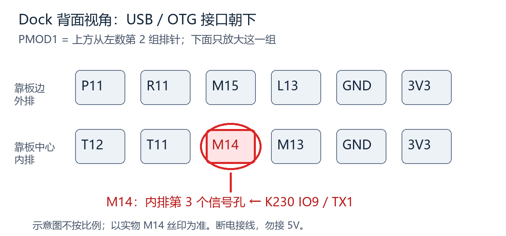

> 2026-10-22位置更正：此前“外排第3孔”有误。M14为**内排第3孔**，外排对应孔是M15。码流约束仍为M14，无需因此改程序；不要照旧位置接。

# E025 串口手势完整工程候选与接线

状态：FPGA/安卓候选已完成离线构建、归档，待实板验收。不是已经部署的完整赛题成品。原 E023 Flash 保留；本轮没有下载任何设备。

## 新增接线（全部断电后接）

| K230 亚博标准版 EXPORT 丝印 | Tang Primer 20K Dock |
|---|---|
| IO9 / TX1（UART1_TXD） | **M14**（FPGA K230_RX，只输入，3.3V LVCMOS，上拉） |
| GND | PMOD1 真实 GND |
| IO10 / RX1 | 不接，当前单向发送不需要 |
| 5V | 不接杜邦线，保留 Dock OTG 到 K230 OTG 的既有供电 |

PMOD1背面定位与 docs/oled-esp-wiring-20261020.md 中同一视角：接口在下、PMOD在上，PMOD1外排从左到右 **P11、R11、M15、L13、GND、3V3**；内排为 **T12、T11、M14、M13、GND、3V3**。M14为靠板中心的内排第3个信号孔。正面看会镜像；优先找球位丝印，不按颜色猜。OLED用T11/P11、ESP用T12/R11，均不挪动。M14由最终PNR报告复核 Bank1 / LVCMOS33，非之前OLED/ESP所用Bank2。

不要把5V、TX接TX或RS232接口接到M14。K230准确IO9复用由另一聊天核实；其板端电平证据与备份/发送程序见 [K230 UART候选说明](k230-uart-sender-20261022.md)。若未确认是3.3V输出，接线不能被视作电气验收。本轮没有实测电平、温度、电流或供电余量。

## K230实物丝印：区分两组接口

按亚博《FPIOA引脚分配.pdf》第2–3页、标准版说明书第3图核对。以下是板子实际丝印，不是Linux GPIO设备编号。

散热片旁双排12针：以PDF图片中摄像头在上、USB在右的视角，行从上到下：

| 左列（奇数脚） | 右列（偶数脚） |
|---|---|
| 1：IO42 | 2：IO43 |
| 3：IO33（RX3） | 4：GND |
| 5：IO32（TX3） | 6：IO26 |
| 7：GND | 8：IO34 |
| 9：5V | 10：IO35 |
| 11：5V | 12：3V3 |

**这里IO32是UART3_TXD，不是本候选的UART1_TXD。不能因为有TX功能就直接替换现有IO9接法。** UART3还需核查当前固件控制台占用，未授权/未验证时不切换。

当前E025配套K230程序选的是USB旁白色四针**EXPORT通讯口**：标准版说明书正面、USB在右的视角，从上到下丝印为**5V、GND、IO9、IO10**。实际接**IO9（第三位）→Dock M14、GND（第二位）→Dock GND**；第一位5V和第四位IO10都不接。本机该GPIO扩展PDF截图在E:/gaoyun/tools/smoke/k230-fpioa-1.png。板姿态不同会旋转/镜像，以实物丝印为准。

## 既有接线不变

| 模块信号 | Dock |
|---|---|
| PCM DATA / BCK / LRCK | P6 / R8 / P8 |
| PCM GND | 真实GND；PCM USB独立供电，PCM +3.3V排针悬空 |
| ADS SCL / SDA / VDD / GND | T6 / T7 / 真实3V3 / GND，ADDR接GND |
| 摇杆 VRX / VRY / SW | ADS A0 / ADS A1 / T8，摇杆由3V3供电 |
| 八路 SCL / SDA | T9 / P9；用户既有供电为Dock3V3，ST-Link已拔除 |
| OLED SCL / SDA / VCC / GND | T11 / P11 / 真实3V3 / GND |
| ESP TX / RX | T12 / R11；保持用户当前3V3/GND方案，峰值电流余量未测 |

所有模块共地。历史核心板快速发热根因没有查明，若再次异常发烫立即断开全部电源；软件测试不解除硬件问题。

## 程序与行为

- FPGA top仍为instrument_extension_top，新用户码E025；不包含实验USB host，OTG不再承担数据枚举。
- UART 115200 8N1，无流控；27MHz每bit234周期（约115385 baud）。包与既有docs/k230-gesture-protocol-v1.md一致，固定12字节A55A/版本01/序号/有效位/捏合/高度/置信度/CRC16。
- 原始置信度门限60不变；坏CRC、重复/旧序号、越界包拒收；250ms没有新合法包释放。无效包也释放，不靠旧包维持手势。
- 手势不触发任何音符。捏合0..1000映射0..255音量上限，不能放大原信号；手部高度映射声部明亮度，覆盖摇杆Y。摇杆X仍弯音。失联/丢手恢复本地音量和摇杆Y。
- 明亮度每音频帧最多移动4单位，音量用既有逐帧slew。手势在测试/包络编辑模式不应用。四键/光键、复音、ADSR、音色、硬件延时、32声部测试、OLED、Wi-Fi功能继续保留。
- 冷启动保持原安全门：按住S1+S2，向下按压并松开摇杆，再松开两键；只做一次。等待八路模块约20秒。重复组合会关闭外设。

## 安卓0.3

保留Wi-Fi控制、四触屏键、音量/音色/延时/音区、键位重排、32点波形和事件CSV。增加K230有效状态、手势序号、置信度、捏合/高度条及演奏帮助；CSV追加这些字段。兼容E023的S状态帧，旧固件显示“不提供手势状态”。

E025回传 **96字节（含LF）**：以G代替S，前84字符布局不变，后追加active1hex、seq2hex、pinch3hex、y3hex、confidence2hex、LF。ESP的CIPSEND长度同步96，不能使用旧85字节长度。APK接受84字符S旧帧和95字符G新帧，均有范围和帧长校验。

Wi-Fi只是控制与状态，未增加无线音频。手机扬声器监听仍需正确外部音频输入；单根AUX不会自动变成手机线路输入。事件CSV不是录音，也不是精确音符时间。未完成的在线曲谱下载/LED谱引导/音频回传/蓝牙等赛题扩展不能声称已完成。

## 回家后验收顺序

1. 两板断电，按表接IO9/TX1→M14和GND；核对不是5V脚；其余线不动。
2. 先在电脑端按K230聊天说明部署并验证UART开机发送（旧main文本预览不会自动改成串口手势发送）；再恢复既有Dock OTG供电。
3. 下载E025到SRAM，保留E023 Flash；启用外设后，先确认静音/心跳/板温无异常，再试板载键和光键。
4. 按住一个演奏键，举手：捏合改变音量，高度改变明亮度；移开手后恢复本地控制。没按演奏键时举手不能自动响。
5. 手机连FPGA-Instrument热点，打开APK连接192.168.4.1:9000；确认FPGA回传序号持续变化、手势字段与实际动作对应。试触屏键、旧本地操作及CSV导出。
6. 验收通过后才另行决定是否写Flash。不能把本轮离线通过当作已完成第3–5项。

## 离线验收与版本文件

34组RTL测试全部通过；另以接收234/发送235周期验证实际波特率约0.43%偏差。Java协议、旧/新帧TCP分片、合成测试和4项Python桥测试通过，APK构建验签成功。K230侧7a4af32的31项主机测试通过，未部署。Gowin 27MHz约束setup/hold违例0，Fmax27.927MHz。

APK：mobile-companion/apk/instrument-companion-0.3-uart-gesture.apk；旧0.2归档在apk/archive/。本机码流：E:/gaoyun/releases/instrument-E025-20261022/instrument-E025.fs，FS沿用仓库忽略规则不强行上传。SHA256、构建与测试证据见logs/20261022-E025-manifest.json及同前缀日志。E023原Flash和原归档均未改动。
