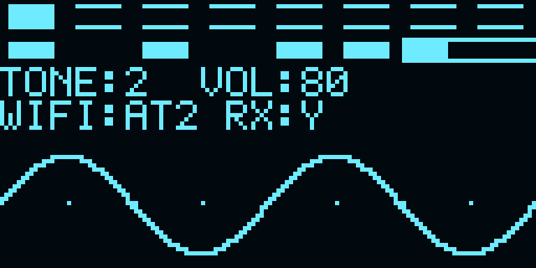

# E022 OLED波形显示候选

当前板上Flash仍为E021；E022仅离线构建，尚未下载或完成实物验收。E021及CF73回退文件均保留在 `E:/gaoyun/releases/instrument-E021-20261021`。

## 显示内容

图片由RTL仿真实际输出的1024字节显存生成，使用正弦测试输入；不是实物照片。颜色仅为预览配色，实物颜色由OLED决定。

- 第一行：八个光键框，按下填充。
- 第二行：左侧六个原运行状态标记（启用、光键、ADC、编辑、测试、延时），右侧音频峰值条。
- 第三行：`TONE:1..4`和远程音量十六进制`VOL:00..FF`。
- 第四行：`WIFI:ON`表示六步AT配置均获OK；否则`AT0..5`显示当前初始化步骤。`RX:Y/N`表示启用后是否曾收到串口字节，末尾`!`表示曾发生AT等待超时。RX:Y本身不等于AT通信成功。
- 下半屏：128列连线波形、中心参考点。输入是效果器和远程音量之后的实际音频采样。

## 提速与稳定性

旧版每个显存字节都新建I²C事务，E022将地址0x78、数据控制字0x40及1024字节显存连续发送。命令与显存共用引脚，两个开漏状态机交替使用，不驱动高电平。重置释放引脚，NACK/超时退出并由显示模块重试，不等待音频模块。

27MHz、HALF_TICKS=36的最终参数仿真：一帧显存数据传输682341时钟，连续两帧首字节间隔697743时钟，即约25.84ms、**38.70帧/秒**。这是理想上拉/应答模型下的主机写屏速率，不是已测得的面板光学刷新率；外接杜邦线的上升时间、噪声和时钟拉伸可能降低实物速率。未使用1MHz超频。时序按SSD1306手册的2.5µs最小周期及300ns输入保持要求设计；加入低电平期间的数据保持，参数36的独立测试验证保持时间。

波形以正向过零触发，每4个音频帧取一点，收满128点后冻结。显示端只复制完整捕获；发送期间保持快照稳定。无过零时1024个音频帧后自动触发，静音也更新。相邻采样点用竖线连接，减少离散点造成的断裂。每列约85µs，整幅约10.9ms；不是任意频率都无混叠的测量示波器，也不宣称满足比赛≤5ms可视化延迟。音频采样率和演奏路径未随写屏提速而改变。

## 开源参考与取舍

- [Adafruit SSD1306 display()](https://github.com/adafruit/Adafruit_SSD1306/blob/master/Adafruit_SSD1306.cpp)：先设置显存寻址窗口，再批量发送缓冲区；MCU库受Wire缓冲大小限制会分块。本项目借鉴批量传输思路，以独立RTL连续发送，无MCU绘图。
- [huseyink/ssd1306](https://github.com/huseyink/ssd1306)：非阻塞状态机、显存与局部脏页更新方案。E022采用独立状态机和冻结快照；由于波形区域持续变化，先保证整屏连续写入，未声称实现脏页更新或DMA。
- [Premraj02/OLED-Controller-Verilog](https://github.com/Premraj02/OLED-Controller-Verilog)：参考FPGA直接驱动SSD1306的结构；没有直接引入该项目RTL。
- [Solomon Systech SSD1306数据手册，表13-6](https://cdn-shop.adafruit.com/datasheets/SSD1306.pdf)：I²C时序依据。

以上为架构参考，新增RTL独立编写，没有拷入第三方驱动或MCU库。

## 验证与后续

- 新增连续传输测试：完整1024字节顺序、仅一个START、NACK、时钟卡住超时、重置释放。
- 新增采集测试：正向过零、4倍抽取、坐标限制、完整捕获冻结、静音自动触发。
- OLED解码测试检查实际I²C输出的键框、状态、文字关键字形、幅度条和波形像素；默认参数单独计时。
- 原有音频、光键、安全启用、AT、音量等回归保留。机器结果和最终构建信息见 `logs/20261021-E022-verification.json`。
- 后续先用SRAM比较按键、音色切换和波形观感，再确认是否更新Flash；本轮不自动覆盖E021。历史发热及ESP电源预算仍未以测量排除，显示提速不代表硬件问题已解决。
