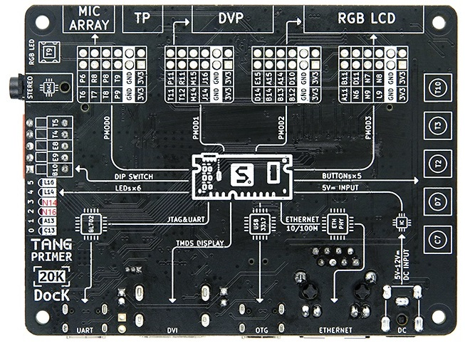

# Dock背面定位与OLED/ESP新增接线（2026-10-20）

状态：引脚分配方案，尚未接线验收、未增加HDL驱动或下载。保留现有CF73与PMOD0。历史wiring-all-current.md中的ST-Link给八路5V方案已过时；当前用户确认八路标5V脚接Dock3V3、ST-Link供电拔除，额定兼容仍待核实。

图片是背面：四排PMOD在上，按键在右，USB/网口在下。从左至右PMOD0、1、2、3。PMOD1为左数第二组；观察正面、接口仍朝下时则左右镜像，为右数第二组。不要按线色猜。

## PMOD1坐标（只适用与上图相同背面视角）
| 行/从左到右 | 1 | 2 | 3 | 4 | 5 | 6 |
|---|---|---|---|---|---|---|
| 靠板边的外排 | P11 | R11 | M14 | L14 | GND | 3V3 |
| 靠板中心的内排 | T11 | T12 | M13 | L13 | GND | 3V3 |

若从正面看且USB/网口仍在下，每排从左到右反转：外排3V3/GND/L14/M14/R11/P11，内排3V3/GND/L13/M13/T12/T11。外排/内排不变。固定板姿态不同应先以USB、按键和PMOD0现有线定位，不能只照屏幕左右数。

## 四针OLED（用户确认GND VCC SCL SDA）
- GND→PMOD1真实GND；VCC→PMOD1真实3V3。
- SCL→T11（内排左1）；SDA→P11（外排左1），均按背面视角。
- 本地商家资料为SSD1306 IIC版本，含上拉，驱动地址仍需实际ACK确认；不以目录中SPI例程判断此四针模块。
- 显示波形/图形及I2C主机由FPGA HDL实现，现有固件没有该功能；断电接线，供电前核对新码流未用引脚设置与I2C开漏，不能把接好线当作可点亮。

## ESP-01S候选串口
- ESP TX→T12（FPGA RX，内排左2）。
- ESP RX→R11（FPGA TX，外排左2）。
- ESP GND→Dock真实GND。
- ESP 3V3供电来源待用户确认，不先接Dock3V3，不接5V，不并接不同3V3输出；需稳压与足够峰值电流。EN/RST/IO0/IO2的启动上拉按模块实际电路核实，不凭8针外形盲插。
- 从大开发板测试串口迁移时须断开原GPIO4/5到小ESP的TX/RX，避免两个TX输出相连；供电问题与串口问题分开确认。
- ESP新接口当前未驱动、不能上电直接期待AT联通。后续FPGA UART先按115200检测，测试中9600只临时设置，不能假定掉电保留。

T11/P11/R11/T12经Gowin GW2A-18C PBGA256 PIN_DATA确认均Bank2，SOM原理图VCCO2/N12接+3V3；当前instrument_io约束未占用这四脚。PMOD1同时是其他扩展接口共享脚，不可再并插DVP/触摸等对应外设。

## 既有PMOD0不动
T6 ADS SCL；T7 ADS SDA；T8摇杆SW；T9八路SCL；P9八路SDA；P6 PCM DATA；R8 PCM BCK；P8 PCM LRCK。PCM排针3.3V不接，USB供电。

## 同项目ESP交接
已获用户授权询问“检测本机 ESP 连接”任务，收到E:/gaoyun/tools/esp-handoff.txt：大板实测为ESP8266EX/4MB而非ESP32，小模块AT1.2.0.0/SDK1.5.4.1，AT及22热点扫描通过；原小板固件未改。大板USB供电，余量未知；双方都没有蓝牙。只读来源用于型号核对，不在此直接操作它的COM14或刷固件。日志见E:/gaoyun/tools/esp01-tester，含无线环境与设备身份的原始数据不自动上传。
