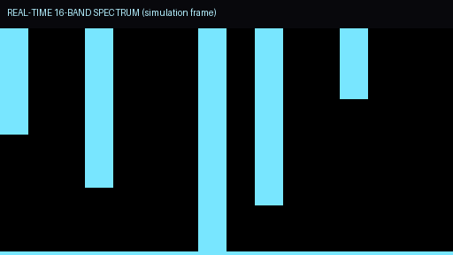
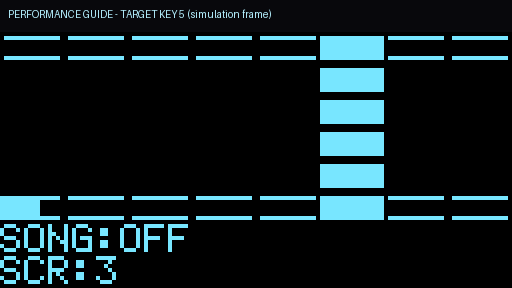

# E027 / E028 FPGA 电子乐器扩展工程

本工程在 **E027 干净基线** 上实现赛题“拓展项”所需的 32 复音引擎、多维表情、内部效果器、实时视听反馈、脱机 LED 曲目指引和 BLE/App 串口联动。

> 基线说明：GitHub `main` 最新提交仍是 **E026**；本地最完整且已综合成功的基线是 **E027**。2026-10-27 修改过的 `Gowin-E027-Project` 中 `optical_keys_reader.v`（`1pso`、`sate`）和 `io_arm_control.v` 有语法错误，未编译成功，因此本工程不采用该修改版。

## 1. 已实现内容

| 赛题拓展要求 | 本工程实现 |
|---|---|
| ≥32 复音、独立相位/频率/包络 | `synth32.v`：32 个固定音高槽位（C3–G5），每声部独立 32 位相位累加器、16 位包络电平/计数器/状态、力度和音色；一个音频帧 576 时钟内完成 32 声部（约 288 时钟） |
| ≥3 维演奏表情 | 力度（按键时摇杆 Y 采样）、弯音（摇杆 X，±2 半音）、颤音（App/K230 捏合）、亮度低通（App/K230 高度）、震音、总表情音量；`tb_features.sv` 验证音色/表情/弯音 |
| ≥2 种可辨识音色 | 4 种：E.Piano、Organ、Strings、Bass，独立谐波权重/包络/失谐，可在演奏中切换 |
| FPGA 内部效果器 | `fx_engine.v`：合唱（320–447 样本调制延迟）、延迟（2047 样本，43.7 ms，反馈）、混响（2 线 FDN + 2 级 Schroeder 全通），立体声输出 |
| 实时频谱/波形 | `spectrum16.v` 16 段 biquad 滤波器组（100 Hz–10 kHz，每音频帧更新）；`oled_ui.v` 波形、频谱、李萨如、演奏指引、状态共 5 屏 |
| 演奏指引/李萨如 | OLED 第 3 屏八键框高亮目标键；第 2 屏 X/Y 李萨如（荧光衰减）；OLED 第 4 屏状态 |
| 脱机 LED 曲目指引 | `song_player.v` 内置《欢乐颂》64 步（16 s 循环）+ 低音；`led_guide.v` 用 4 颗板载 LED 显示目标键组与节拍；不依赖手机 |
| 蓝牙/App 联动 | FPGA 串口链路与传输无关：`LINK_MODE=1` 时直接接受 BLE-UART 模块的透明 ASCII 命令；`ble-app/` 提供 Android BLE 控制器源码和 APK；Wi-Fi AT 模式仍保留 |
| ≤5 ms 确定性延迟 | 全硬件帧同步，无软件/中断在音频路径；`tb_core.sv` 实测按键→合成样本 **1.409 ms**；音频 46.875 kHz，I2S 1.5 MHz |

## 2. 目录

```text
E027_Ext/
  src/            当前综合用 RTL（27 个文件）
  constraints/    E027 Dock 引脚 + 27 MHz 时序约束
  sim/            ModelSim 回归（tb_core / tb_synth32 / tb_features / tb_fx /
                  tb_spectrum / tb_oled_ui / tb_song_led / tb_command）
  sim/legacy/     旧 E027 testbench，仅存档
  legacy/         旧 E027 RTL（4 声部/测试库），不参与综合
  tools/          Gowin 构建脚本
  proj/           构建输出（instrument_e028.fs / .bin / 报告）
  ble-app/        Android BLE 控制器（源码 + APK）
  docs/           验收对照、设计说明、测试报告、协议、上板指引
```

## 3. 构建

```powershell
cd "E:\DS working space\E027_Ext"
& "D:\Gowin\Gowin\Gowin_V1.9.11.03_Education_x64\IDE\bin\gw_sh.exe" tools\build_e028.tcl
```

输出：

```text
proj/instrument_e028/impl/pnr/instrument_e028.fs
proj/instrument_e028/impl/pnr/instrument_e028.bin
```

最近一次结果：**Fmax 32.938 MHz**（约束 27 MHz），setup/hold 违例 **0/0**，CLS 78%，BSRAM 15/46，DSP 8.5/24。详见 `docs/测试报告.md`。

## 4. 引脚与板级变化

音频、ADC、光键、OLED、ESP、K230 引脚与 E027 完全一致。

唯一变化：**N16/N14 不再只是心跳/ADC 灯，而是与 L16/L14 一起作为 4 颗板载 LED 曲目指引**。

```text
led[0] = L16
led[1] = L14
led[2] = N14
led[3] = N16
```

A13/C13 在 GW2A-18 封装上是专用 READY/DONE 引脚，不能作为普通 LED 使用；原 E027 文档中的“六灯”不适用于本封装，已改为四灯。

## 5. 演奏与面板操作

| 操作 | 功能 |
|---|---|
| 光键 0–7 | 当前页 8 个音；page 0–3 对应 C3–G5 共 32 个音 |
| 板载 S1–S4 | 同时作为高音区 4 个音（E5/F5/F#5/G5），短按还承担面板功能 |
| S1 短按 | page +1（0→3 循环） |
| S2 短按 | OLED 屏幕 0→4 循环 |
| S3 短按 | 脱机曲目开始/停止 |
| S3 长按 1 s | 锁存（latch）开/关；配合 8 键×4 页可累积 32 个音 |
| S4 短按 | 效果预设：关→合唱→合唱+延迟→全部 |
| S4 长按 1 s | 32 声部压力测试（32 个 gate 全开） |
| 摇杆点击 | 切换音色（E.Piano→Organ→Strings→Bass） |
| 摇杆 X | 弯音 ±2 半音 |
| 摇杆 Y | 新音力度（同时 App 可控制亮度） |
| K230 捏合/高度 | 颤音深度/亮度（手势有效时） |

OLED 屏幕：

```text
0 波形（效果后真实音频，过零触发）
1 16 段实时频谱
2 李萨如 X/Y（立体声后级信号）
3 演奏指引（八键框，高亮下一音；底部进度）
4 状态（音色/效果/声部数/延迟/曲目/屏幕号）
```

由 RTL 仿真输出的实际 1024 字节显存渲染（不是实物照片）：





## 6. 串口协议

默认 `LINK_MODE=0`：ESP-01S AT/TCP，沿用 E027 的 `+IPD` 封装；`LINK_MODE=1`：BLE-UART 透明模式，直接发送 ASCII 行。

```text
Vxx   音量 00..FF          Txx   音色 00..03
Kxx   8 位键掩码            Pxx   页 00..03
Fxx   效果位 {混响,延迟,合唱} Mxxxxxxxx  32 位音符掩码
Bxxxx 弯音 0000..3FFF（2000 中心） Xxx 颤音深度
Yxx   亮度                  Sxx   OLED 屏 00..04
Rxx   脱机曲目 0/1          Hxx   锁存 0/1
Dxx   32 声部压力测试        Q00   保活
L00   释放
```

详见 `docs/协议.md`。

### Android BLE App

`ble-app/dist/FPGA-BLE.apk`（49,636 bytes，SHA256 `9FE8CCDE88C8A8FBE772107E47938438F1C2165507C30C73C243F9D70983E244`）：
扫描/连接 HM-10（FFE0/FFE1）或 Nordic UART、8 键多点触控、音量/音色/效果/页/曲目/锁存/32 声部压力测试、弯音/颤音/亮度/OLED 屏。

App 是 BLE-GATT，不支持经典 SPP-only 的 HC-05；请使用 HM-10/AT-09/JDY-08 或 Nordic UART 模块。未做真机配对。

## 7. 验证边界

已完成：

- Gowin 综合、布局布线、码流生成；时序 0/0 违例。
- ModelSim：32 声部、4 音色、表情/弯音、效果器、频谱、OLED 频谱/指引、曲目/LED、命令解析、按键→音频延迟。
- 延迟仿真值 1.409 ms；未做示波器/逻辑分析仪实物测量。
- **2026-10-28 已实际写入外部 Flash（初次 E028，SHA256 E7DC…）并通过 operation 37 Program+Verify；冷启动只读 UserCode=0xE028、Status=0x6020。**
- 后续修复自动放歌/包络/爆鸣的 SRAM 候选为 SHA256 `D398867D…`；**尚未写回 Flash**，需实物确认后再持久化。
- 已确认此前“解锁自动放歌”的根因是 S1+S2 启动组合松开 S2 被误判成短按；已加 1 s 面板屏蔽并修正 S1–S4 映射。
- 已修正释放包络过长（由 1 LSB/帧改为 175–350 ms）、增益随声部数跳变、32 声部同相爆鸣；默认效果器改为干声。
- 实物音频/爆鸣/OLED 显示仍在复测；未做 BLE 实物配对、温升/长期运行验收。

因此文档中“通过”仅指仿真、构建或已记录的实测量；未确认的听感/显示问题不写成通过。操作见 `docs/使用指南.md`。

## 8. 重要限制

- 4 颗板载 LED 只能把 8 键分成 4 组；具体键位由 OLED 指引屏给出，不能声称“8 灯一一对应”。
- 32 声部是 32 个固定半音槽位；8 个光键一次只能直接触发其中 8 个，需配合 page/latch 或 App 的 `M` 掩码才能同时点亮 32 个。
- 内部效果器为单声道输入、立体声混合；不是专业级混响算法。
- BLE 模块需 3.3 V 供电、与 FPGA 共地，TX/RX 交叉；不要用 5 V 直接送 FPGA 引脚。
- 本工程未修改 OTP 或下载器；外部 Flash 已于 2026-10-28 写入 E028 并校验。再次烧录前核对设备、码流哈希与地址，禁止 bulk erase。

## 9. 使用指南

完整操作见 [docs/使用指南.md](docs/使用指南.md)。最重要的一条：**每次上电/重启后必须做 S1+S2+摇杆解锁**，否则 OLED、I2S 和 LED 都处于复位状态；解锁后 1 秒内静音是正常的。
